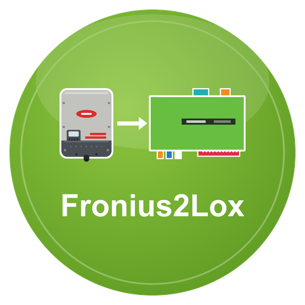

# Fronius2Lox – LoxBerry-Plugin

**Version 0.5.2** · Benötigt LoxBerry 4 (PHP ≥ 8.2) · [Changelog](CHANGELOG.md)

Dokumentation: [docs/wiki/Home.md](docs/wiki/Home.md)

Liest die **Fronius Solar API** (Wechselrichter Gen24, Symo, Primo …) und veröffentlicht PV-Leistung, Hausverbrauch, Netz, Batterie und Zähler per MQTT am LoxBerry-Broker (→ MQTT-Gateway → Loxone). Ersetzt den ioBroker-Adapter `fronius`.

Alle in der offiziellen Solar-API-Dokumentation beschriebenen Werte werden übernommen: Energiefluss, Wechselrichter (auch 3-Phasen, Extremwerte, Status mit Klartext, Gerätetyp), Smart Meter, Speicher mit Modulen, OhmPilot, Sensorkarte, String Control, Datenlogger sowie letzter Fehler und Ereignisse des Tages. Welche Geräte es gibt, erfragt das Plugin beim Wechselrichter selbst (nur lokal, keine Cloud). **Nachts abgeschaltete Wechselrichter** (Symo/Primo mit Datamanager) sind der Normalfall: `schlaeft` = 1, `pv_w` = 0, kein Fehler.

## Installation
1. `bash build.sh` → `fronius2lox-<version>.zip` (oder ZIP von den Releases)
2. In LoxBerry → Plugin-Verwaltung → ZIP installieren.
3. **Gen24:** im Wechselrichter die Solar API freischalten (Kommunikation → Solar API).
4. Plugin öffnen, Reiter „Einstellungen“: IP des Wechselrichters eintragen, **Aktiv** anhaken, speichern.
5. Reiter „Test“ → „Sofort abrufen“ und „Selbstprüfung“. Werte erscheinen unter `fronius/<name>/*`.

**Immer das neueste Release:** `https://github.com/ricten/Fronius2Lox/releases/latest/download/fronius2lox.zip` (ZIP ohne Version im Namen). **Automatische Updates:** Neue Installationen stehen in der Plugin-Verwaltung auf „Releases“, LoxBerry prüft täglich die `release.cfg` im Repository und installiert neuere Versionen selbst (Details: [docs/wiki/Installation.md](docs/wiki/Installation.md)).

## Topics (Auszug)
`fronius/wr1/pv_w`, `haus_w`, `netz_w` (+ Bezug / − Einspeisung), `batterie_w` (+ Laden / − Entladen), `batterie_soc`, `energie_tag_wh`, `wr/1/…`, `zaehler/0/…`, `speicher/0/…`, `ohmpilot/0/…`, `verbunden`, `schlaeft`, `fronius/status/ok|zaehler|ts`.
Vollständige Liste: [docs/wiki/MQTT-Topics.md](docs/wiki/MQTT-Topics.md).

## MQTT-Broker
Standard ist der Broker des LoxBerry (Zugangsdaten verwaltet LoxBerry). Alternativ lässt sich im Reiter „MQTT“ ein eigener Broker eintragen.

## Entwicklung
- Tests: `php tests/run.php`
- Details und Regeln: [CLAUDE.md](CLAUDE.md), [docs/wiki/Entwicklung.md](docs/wiki/Entwicklung.md)

## Lizenz
MIT, siehe [LICENSE](LICENSE). Fronius ist eine Marke der Fronius International GmbH; dieses Plugin ist inoffiziell.
