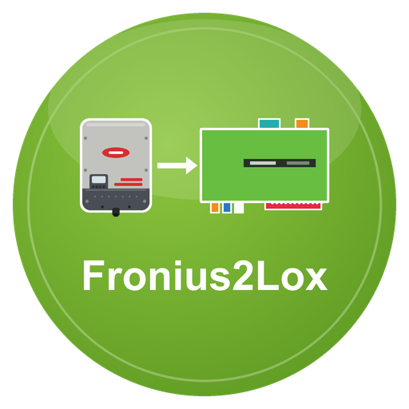

# Fronius2Lox

**Fronius2Lox** ist ein LoxBerry-Plugin, das die **Fronius Solar API** (Wechselrichter Gen24, Symo, Primo …) ausliest und die Werte an den MQTT-Broker des LoxBerry veröffentlicht.
Über das LoxBerry-MQTT-Gateway gelangen sie an den Loxone Miniserver. Es ersetzt den ioBroker-Adapter `fronius`.

## Was kann das Plugin?

- Liest bis zu **4 Wechselrichter bzw. Datamanager** im Netz, jeden unter einem eigenen Namen (`fronius/wr1/…`)
- **Energiefluss:** PV-Leistung, Hausverbrauch, Netz (Bezug/Einspeisung), Batterie (Laden/Entladen, Ladestand), Erträge heute/Jahr/gesamt, Autarkie, Eigenverbrauch
- **Wechselrichter-Details:** Spannungen, Ströme, Frequenz, Status mit Klartext, Fehlercode
- **Smart Meter** (je Phase) und **Batteriespeicher** (Temperatur, Kapazität), wenn vorhanden
- Optional **alle Rohwerte** der Antworten als Topics
- Nachts bleibt die PV-Leistung bei 0 statt auf dem letzten Wert zu stehen
- **Nachtbetrieb:** Schaltet der Wechselrichter nachts ab (Symo/Primo mit Datamanager), ist das kein Fehler: `schlaeft` = 1, `pv_w` = 0, `status/ok` bleibt 1
- **Alle in der Fronius-Doku (Solar API V1) beschriebenen Werte:** Energiefluss, Wechselrichter (auch 3-Phasen und Extremwerte), Smart Meter, Speicher mit Modulen, OhmPilot, Sensorkarte, String Control, Datenlogger, Gerätetyp mit Klartext, Statuscodes, letzter Fehler und Ereignisse des Tages
- Welche Geräte vorhanden sind, fragt das Plugin beim Wechselrichter selbst ab; es nutzt ausschließlich die lokale Schnittstelle, keine Cloud
- Rein lesend: das Plugin schreibt nichts in den Wechselrichter
- MQTT-Broker des LoxBerry oder **eigener Broker**
- Lebenszeichen `fronius/status/ok|zaehler|ts` für die Ausfallerkennung in Loxone
- Weboberfläche mit Erreichbarkeitsanzeige, Topic-Tabelle, Selbstprüfung und Log

## Seiten

1. [Installation](Installation.md)
2. [Konfiguration](Konfiguration.md)
3. [MQTT-Topics](MQTT-Topics.md)
4. [Loxone-Anbindung](Loxone-Anbindung.md)
5. [Fehlersuche](Fehlersuche.md)
6. [Entwicklung](Entwicklung.md)

## Voraussetzungen

- LoxBerry ≥ 4.0 mit aktivem MQTT-Broker (Mosquitto) und MQTT-Gateway (oder eigener Broker)
- PHP ≥ 8.2 (Kommandozeile und Web). Das hat LoxBerry 4.0 auf Debian 13 (Trixie); auf Debian 11 und 12 ist meist PHP 7.4 aktiv, dann zuerst die Debian-Version anheben ([Anleitung im LoxBerry-Wiki](https://wiki.loxberry.de/installation_von_loxberry/upgrade_distribution/start)). Die Installation prüft das und bricht sonst mit einem Hinweis ab
- Ein Fronius-Wechselrichter im Netz mit **freigeschalteter Solar API** (bei Gen24 im Wechselrichter einzuschalten)

## Lizenz

MIT, siehe [LICENSE](../../LICENSE). Fronius ist eine Marke der Fronius International GmbH; dieses Plugin ist inoffiziell.
